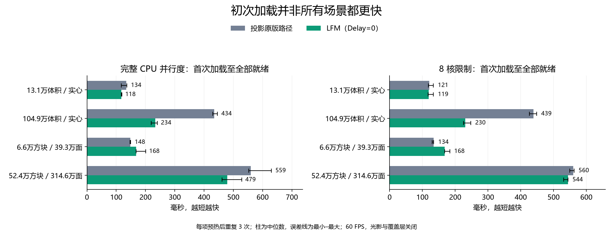
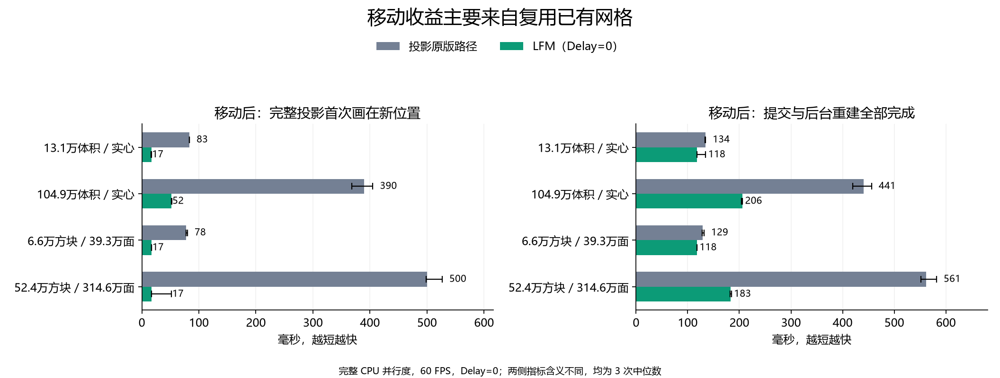
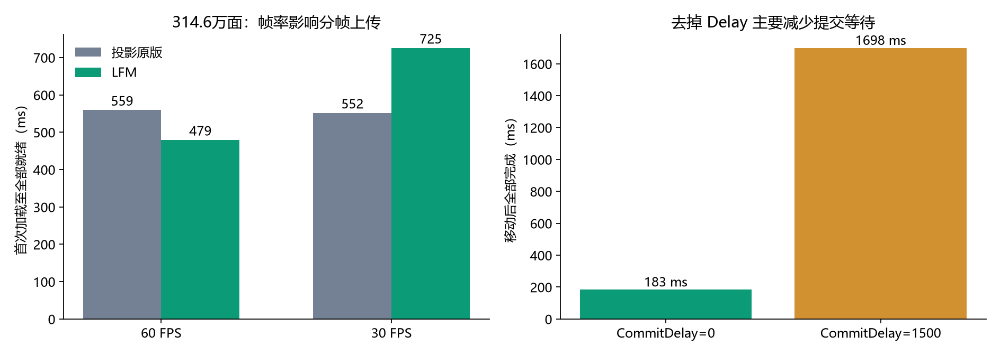

# 1.20.4 零延迟加载测试（2026-10-21）

移动复用网格的收益明显；首次加载依赖场景、线程数和实际帧率，不能承诺普遍加速。

| 24 逻辑 CPU / 实际 60FPS | 原版 Litematica | LFM |
| --- | ---: | ---: |
| 百万体积实心图，首次全部就绪 | 434.2 ms | 233.9 ms |
| 52.4 万独立方块 / 314.6 万面，首次全部就绪 | 559.2 ms | 479.0 ms |
| 同一高面数图，移动后首帧完整画面 | 499.9 ms | 16.6 ms |
| 同一高面数图，移动后全部提交完成 | 561.4 ms | 183.4 ms |

## 方法与限制

使用实际普通 Fabric 成品 `1.0.1+1.20.4`，SHA256：
`cc51630d9d092eaf04460d630f311ddacea4697ae44e27f92fee8c571ac7418d`。
该 SHA 对应合并远端元数据之前的实测 jar；重新打包后的字节哈希以各构建的 package-verification.json 为准。

Core Ultra 7 270K Plus、RTX 5060 Ti、32GB RAM、游戏 Java 21、4GB 堆；另做 8 逻辑 CPU 与 30FPS 对照。
固定 854×480、视距16、关闭光影与覆盖层、全方块材质。两个 Delay 与移动平滑都设0。
4个自生成原理图，每种配置1次预热、3次正式交替重复，共114条正式记录；报告中位数。
24逻辑CPU时 LFM默认6个构建线程、原版2个；8逻辑CPU时两者均2个，因此不等同于相同线程数算法比较。
每次卸载后在计时外GC并等待1.5秒，测的是受控热缓存单次延迟，不是冷盘或持续加载吞吐。
全部完成以队列、代际、几何数据和 glFinish 核对；50ms采样及两次空闲确认带来约50ms确认窗口。
后台静音客户端校准实际帧间隔为16.7/33.3ms，避免 Windows 忽略计时请求造成帧率不一致。

小高面数图首次加载为148→168ms，30FPS大高面数图为552→725ms，均有退步。
CommitDelay1500→0主要取消等待，使移动后全部就绪约1.70→0.18秒；文件读取约0.4–3ms。
这是本地原理图读入/构建/上传/显示测试，未测网络下载；不能外推到所有MC版本、光影或真实红石图。

- [完整方法和数值](methodology.txt)
- [114条正式测量](formal-results.json)
- [汇总CSV](summary.csv) / [汇总JSON](summary.json)
- [夹具生成器](generate.py) / [独立NBT校验器](validate-fixtures.py)
- [打包和零延迟配置](../../../BUILDING.zh-CN.md)
